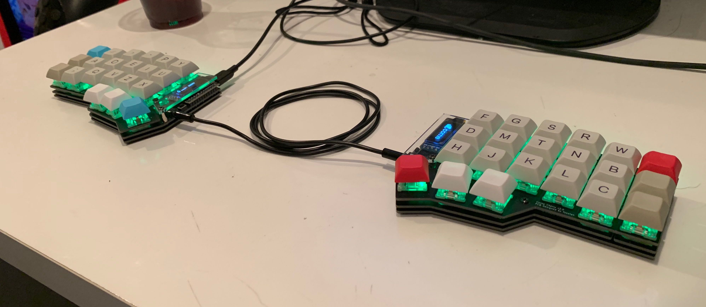
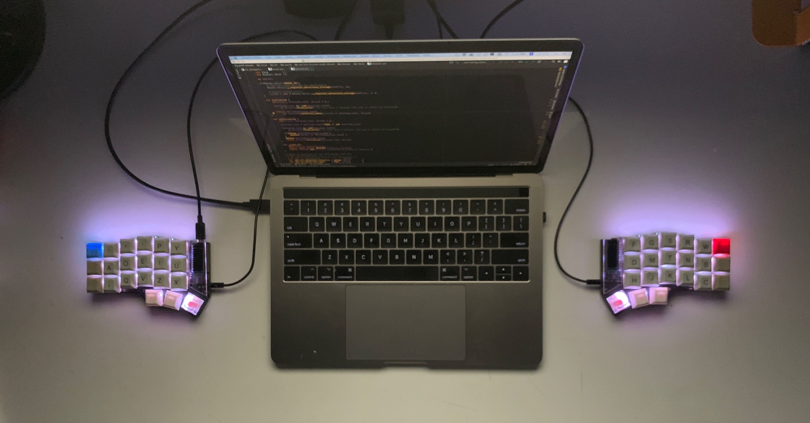
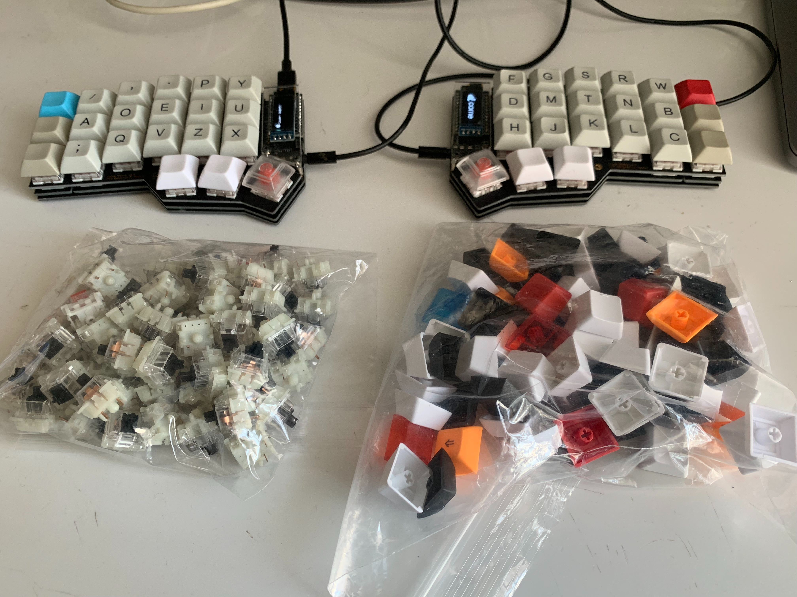

The Corne Keyboard is a DIY keyboard designed by [@foostan](https://twitter.com/foostan).
The hashtag is [#crkbd](https://twitter.com/search?q=%23crkbd&src=typd).
The design is open source and [published on GitHub](https://github.com/foostan/crkbd/).

Note that "Corne Keyboard" is actually something like a collective name for the Corne series; as concrete keyboard types there are several variants such as [Corne Cherry](https://yushakobo.jp/shop/corne-cherry/) and [Corne Chocolate](https://yushakobo.jp/shop/corne-chocolate/).
This time I bought a Corne Cherry kit, so I'll write about my impressions from actually building and using it.

At the time of writing, the kit seems to be sold at Yushakobo's [online store](https://yushakobo.jp/shop/corne-cherry/) and [physical store](https://yushakobo.jp/news/2018/12/07/storeopen/).

## The finished product

I'm very satisfied with both the looks and the feel of use. I use it heavily at work every day.





## How I came across it

I had always wanted a split keyboard, and at first I was thinking of buying something like the Ergodox EZ. But then I fell in love at first sight with a photo of the Corne Cherry that came across my Twitter feed (or somewhere).

## What's great about the Corne Cherry

### It only has 3 rows + thumb keys

As you can see from the photos, it boldly has no number row. While the keyboard on a Touch Bar MacBook Pro has 64 keys, the Corne Cherry has 42 keys—about 2/3 of that.
As a result, you input numbers, symbols, and cursor movements via simultaneous presses using a layer-switching feature. But since I had already been substituting the cursor keys (which are far from the home position to begin with) with ctrl + hjkl, I personally didn't find it that much of a problem. If anything, since every key can be reached within one key of the home position, once you get used to it I came to think it might be the layout that lets you type the fastest with the least stress.

### It looks cool

The form is cool. There's nothing wasted.
The OLED display peeking out from under the clear cover is cool too.

### It's thin

The designer says he's particular about thinness.
By doing things like putting the microcontroller on the outside, the height is kept low, which makes it easy to type on.

### Hot-swap support

By using an electronic component called a PCB socket, the key switches themselves require no soldering, so you can easily remove and replace key switches without soldering (hot-swapping).
I realized this later, but once you've used a DIY keyboard for a while, you almost 100% end up wanting to try other key switches, so being able to hot-swap is a pretty big deal.
Also, being able to strip the key switches off the board and lay it bare for maintenance is subtly convenient.

## And so I bought it

Right after learning about the Corne Cherry, I happened to find out that the kit would be sold at Tech Book Fest 5, held about a week later, and I made up my mind to buy it.
On the day of Tech Book Fest, I arrived about an hour before opening and lined up, then rushed straight to the sales booth right after the doors opened—but there was already a line of about 20–30 people.
By the time it was my turn, the popular colors were already sold out. I bought a matte black kit.

## Assembly

I sourced the keycaps and key switches not included in the kit from [KBDfans](https://kbdfans.cn/), and gathered tools like a soldering iron from Amazon.
It was the first time I'd soldered since middle school, but I got used to it surprisingly quickly, and although it took time I managed to finish without major trouble.
Lots of people seem to have written detailed build logs, so I'll skip mine.

\* That said, soldering the optional LEDs was quite a pain.

## Keymap

For the keyboard firmware I use the OSS [qmk/qmk_firmware](https://github.com/qmk/qmk_firmware).
It's fine as is, but by customizing it you can freely change the keymap and change what's shown on the OLED display however you like. It's written in C, and even if you're not good at C you can manage to make it work by editing it by feel.
Besides the layer feature, qmk also lets you change the input character depending on long-press/short-press, among other things. There seem to be lots of other features I haven't fully grasped.

For now my keymap has settled into the following form.
There are only two layers for character input, including the default. So far that's enough.
I also try to keep the keymap as minimal as possible.

```
Default layer
+---+---+---+---+---+---+    +---+---+---+---+---+---+
|TAB| Q | W | E | R | T |    | Y | U | I | O | P | - |
+---+---+---+---+---+---+    +---+---+---+---+---+---+
|CTL| A | S | D | F | G |    | H | J | K | L | ; | ' |
+---+---+---+---+---+---+    +---+---+---+---+---+---+
|SFT| Z | X | C | V | B |    | N | M | , | . | / |SFT|
+---+---+---+---+---+---+    +---+---+---+---+---+---+
            |CMD|L2 |SPC|    |ENT|L2 |ALT|
            +---+---+---+    +---+---+---+

L2 layer
+---+---+---+---+---+---+    +---+---+---+---+---+---+
| ~ | @ | # | # | $ | % |    | & | * | ( | { | [ | _ |
+---+---+---+---+---+---+    +---+---+---+---+---+---+
| ` | 1 | 2 | 3 | 4 | 5 |    | + | = | ) | } | ] | | |
+---+---+---+---+---+---+    +---+---+---+---+---+---+
| ^ | 6 | 7 | 8 | 9 | 0 |    |   |   | < | > | ? | \ |
+---+---+---+---+---+---+    +---+---+---+---+---+---+
            |CMD|   |SPC|    |ENT|   |ALT|
            +---+---+---+    +---+---+---+
```

There are also layers for non-character input, such as function keys, volume keys, and toggling the LEDs on/off, but I'll omit them here.

#### Keymappings not expressible in the figure above

Since there are fewer keys, you end up making some use of simultaneous presses and long-press/short-press differentiation.

|        Input        | How to input                    |
| :-----------------: | :------------------------------ |
|         \\          | Short-press the right Shift key |
| English/Kana toggle | Short-press Command/Alt         |
|         Esc         | Ctrl + hyphen                   |
|      Backspace      | Ctrl + m                        |

As for simultaneous presses, partly as a holdover from my HHKB days I currently control them in software, using Karabiner-Elements. (I haven't researched it properly yet, but is it possible to configure simultaneous-press keymaps in the firmware too?)

## Actually using it

### My first split keyboard

It was my first split keyboard, and at first I was quite shaky—my typing speed was only about 10% of what it used to be. It was striking how much your body's sense gets reset just by what used to be one thing being split into two.
But that strangeness disappears before you know it after using it for even a week, and (for the alphabet at least) typing speed quickly comes back to about 80% of the original. In my case, after about two weeks of use I could type at the same speed as my old HHKB or faster.

And I feel like my shoulder stiffness went away after switching to the Corne Cherry. Well, I wasn't the type with terrible shoulder stiffness to begin with, but I've come to feel almost no desk-work-related bodily fatigue even when working into the night.
I'd heard that with a split keyboard you type at shoulder width so you don't have to hunch your shoulders, which lets you type with good posture—and I do feel that's effective.

### Number of keys

Compared to a normal keyboard, the numbers and symbols are closer to the home position, so programming became much more comfortable. Since all the keys are close, typing is easy and fun.
When I touch a normal keyboard again, the numbers and symbols now feel very far away.

Personally, I feel these 42 keys really have nothing wasted—it's right at the lower limit of how few keys you can have. I use every key evenly, with no rarely-used keys. Any fewer and it would surely get tough.
In practice, very occasionally I do think I'm short a key. I sometimes want alt or command on both hands. But it's not that critical.
If I were to add keys, I think it would be about +1 thumb key on each side.

### Getting used to it

As mentioned, for the alphabet alone my typing speed became equal to or faster than my long-used HHKB in about two weeks.
The problem is symbols: because there are so few keys, you basically ignore the conventional layout and completely rethink the arrangement, so I struggled at first to memorize it. It's not enough to interfere with work, but I still make quite a few mistakes. For symbols and numbers, it seems best to make the arrangement as rational and regular as possible in your own mind.
I've also assigned ENTER to a thumb key, for example, and that too felt strange at first.

Trying to practice just to get used to it doesn't last, so I felt the quickest way is to deploy it into real work as soon as you can sort of type. That was my strategy too, and sure enough I got used to it in no time once I started using it at work.

Also, midway through getting used to it, there's a phase where for some reason you can't type properly on either a normal keyboard or the Corne Cherry. Like pressing the space key with your thumb when you meant to press enter on a normal keyboard.
And for some reason, once you get past that, you can use both without thinking and the mistakes go away. Strange.

### Other things

This is probably because my soldering is bad, but while using it, keys sometimes suddenly stop responding, or conversely pressing a certain key makes all the keys in that column fire—this happens irregularly. It seems my soldering wasn't done well and there are spots where I've shorted something.
There are times when it was working fine just a moment ago and then suddenly acts up, and when trouble occurs I take it home and do maintenance.

With my current electronics skill, I felt there are some aspects where I just can't beat the stability of a mass-produced product. Will I be able to finish it with quality comparable to a commercial product if I get more skilled?

## And into the rabbit hole

I've started to understand a little the feelings of people whose homes endlessly fill up with keyboards and keyboard parts.

Because DIY keyboards can be customized by yourself a little too easily, you end up wanting to try all sorts of things in pursuit of a more comfortable keyboard, and there's no end in sight.
The temptation of key switches and keycaps in particular is huge. When I first decided to build the Corne Cherry I was supposed to have bought only the bare minimum number of key switches and keycaps, yet somehow I now have enough left over to build another keyboard.



For key switches, I first used silent black switches, but the non-silent ones felt lighter and more pleasant to type on, and before I knew it I'd switched to BOX Red switches.
And now, a week later, I want BOX Black switches. I'll probably go buy them this weekend.

(Addendum: I bought [Tealios V2](https://yushakobo.jp/shop/a02te/) instead of BOX Black. The typing feel and how well the LED light passes through are the best.)

For keycaps, I wanted to try Cherry Profile caps instead of DSA Profile ones, and before I knew it I'd bought them. I've also bought small amounts of keycaps in various colors and keep them in stock.

Other things I'm currently interested in:

- I want MDA or XDA profile keycaps, they're cute
- I want to build a second one
  - I'm confident I should be able to solder better next time
  - Since key switches and such have started piling up, I could probably build a second one, which lowers the bar
- I want to build a wireless DIY keyboard with a BLE Micro Pro and free myself from the hassle of cables

## Summary

DIY keyboards are fun to build and fun to use.
The joy when it properly accepts key input during the operation check after struggling with soldering, or when the LEDs light up correctly, and the way I keep gazing at it—those were feelings I hadn't had in a while.
I want to keep enjoying it from here on.

## Finally

The road to endgame is long.

This article was written on a Corne Cherry Keyboard.
