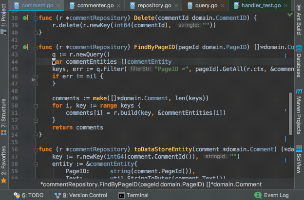
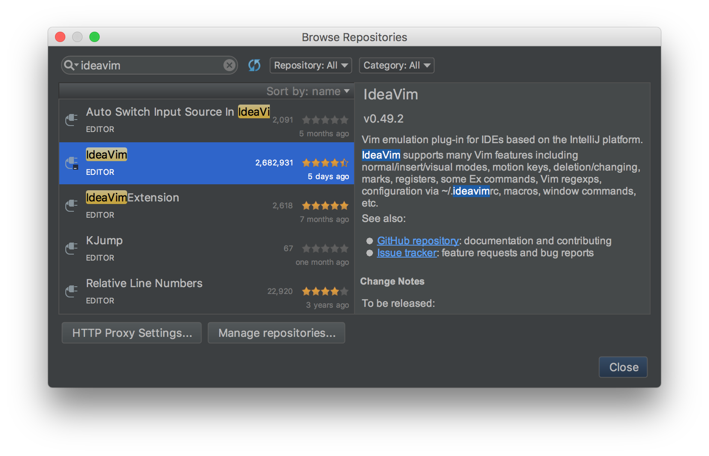
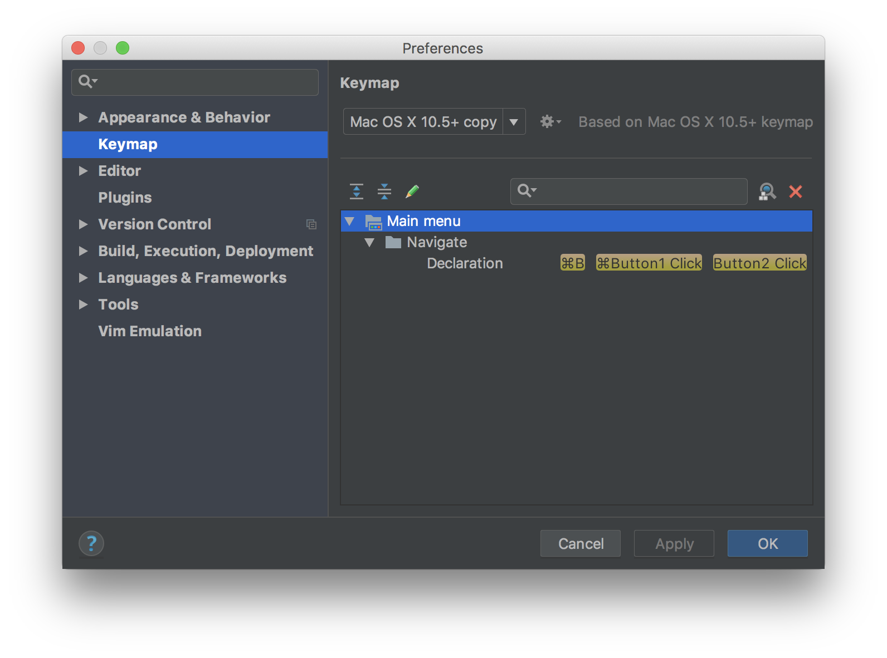
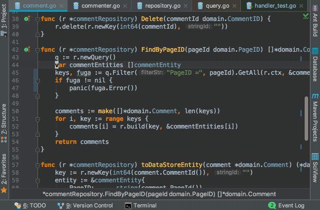

This post is for the final day of the [JetBrains Advent Calendar 2017](https://qiita.com/advent-calendar/2017/jetbrains).
The slot had been empty up until the previous day, so I slid in at the last minute to take part!

## IdeaVim

[IdeaVim](https://plugins.jetbrains.com/plugin/164-ideavim)
GitHub: [JetBrains/ideavim](https://github.com/JetBrains/ideavim)

IdeaVim is **a Vim plugin you can use in JetBrains IDEs such as IntelliJ and Android Studio**. By installing this plugin, you can operate IntelliJ and the like in a Vim-ish way.\
As you can tell from the repository name, it's an official JetBrains plugin. It even gets recommended to you the first time you launch IntelliJ.

\* In what follows, I'll use IntelliJ as the example, but it should be basically the same for any JetBrains IDE, so please mentally substitute whichever one you're using.

### A taste of it

\* The key mappings have been customized.



### Why use IdeaVim

Personally, I find the following things appealing about IntelliJ and Vim respectively:

- **IntelliJ**: the power of features like completion, code navigation, and refactoring, and how easy they are to configure
- **Vim**: the efficiency of its editing operations as a text editor, and the concepts of key mappings and modes

When you use the IdeaVim plugin,
**you can operate IntelliJ with Vim-like key mappings, and you can also invoke IntelliJ's features through those key mappings.**
That's why I believe you can enjoy both of the advantages above at the same time. There are still differences from upstream Vim in some of the finer behaviors, but
**for the features that a relatively light Vim user like me wants from Vim, I think IdeaVim covers most of them.**

In this post, I'll convey what's great about IdeaVim by walking through its features and how to configure it.

## A sample of the features IdeaVim supports

Since it's hard to list every little feature, I've summarized the support status focusing on the ones I personally use a lot.\
I've never had the experience of an operation I wanted to perform being unimplemented, though I suppose that depends on how heavily you use Vim.

| Feature             | Support status                                                                                                                                                                              |
| ------------------- | ------------------------------------------------------------------------------------------------------------------------------------------------------------------------------------------- |
| Modes               | Normal mode, insert mode, and visual mode exist                                                                                                                                             |
| Motions             | Yank (`y`), delete (`d`), change (`c`), undo (`u`), redo (`Ctrl-r`),<br>text object operations (`ciw`, `vi(`, ...), and so on                                                               |
| Search              | You can search with `/` just like in Vim, and incremental search via `:set incsearch` works too                                                                                             |
| Substitution        | Just like in Vim, you can do regex-based substitution with `:s`, `:%s`, `:'<,'>s`, etc.                                                                                                     |
| Commands            | `:w`, `:q`, `:tabnew`, `:split`, some `:set` options, and so on                                                                                                                             |
| Settings & key maps | You can write various `map` and some `set` options in `.ideavimrc` using the same syntax as `.vimrc`<br>You can also map IntelliJ features to keys (explained in detail in a later section) |
| Macros              | Available                                                                                                                                                                                   |
| Registers           | Available                                                                                                                                                                                   |
| Other               | By running `:set surround` you can use a feature that reproduces [vim-surround](https://github.com/tpope/vim-surround)                                                                      |

If you'd like to know more, take a look at the README and so on in
[the GitHub repository](https://github.com/JetBrains/ideavim).

## How to install IdeaVim

Just like a normal IntelliJ plugin, you can install it from `[Preferences] > [Plugins]`.\
Restart IntelliJ after installing and IdeaVim will be enabled.



### EAP builds

As things stand, IdeaVim is only updated a few times a year.
By adding the URL below in IntelliJ via `[Settings] > [Plugins] > [Browse Repositories] > [Manage Repositories]`, you can use an EAP[^eap] build of IdeaVim that hasn't been officially released yet.
[^eap]: Early Access Program

<https://plugins.jetbrains.com/plugins/eap/ideavim>

There are quite a few cases where a bug I'd found inconvenient turns out to be fixed in the EAP build, so I always use the latest EAP build.

## How to configure IdeaVim

### .ideavimrc

In IdeaVim, if you write your settings in a file called `.ideavimrc` and place it in your home directory, IntelliJ will load those settings on startup.\
**Just like upstream Vim's `.vimrc`, you can write various map commands and set commands in `.ideavimrc`.**

You can find the list of available `set`
command options [here](https://github.com/JetBrains/ideavim/blob/master/doc/set-commands.md).\
There's also an IdeaVim-specific option called `set surround`, which gives you a feature that partially reproduces what's known upstream as [vim-surround](https://github.com/tpope/vim-surround).

### Managing Vim and IdeaVim key maps in one place

Since the `map` command can be used with the same syntax as upstream Vim, I recommend pulling basic key mappings like `nnoremap L $` out of your regular `.vimrc` into a separate file called `.vimrc.keymap`, and loading it from both `.vimrc` and `.ideavimrc` using the `source` command.\
By doing this, you can manage the basic key mappings you want to share between Vim and IdeaVim in one place. This is a benefit you get precisely because `.ideavimrc` can be written with almost the same syntax as `.vimrc`.

##### .ideavimrc

```vim
" Load the shared keymap file you pulled out
source .vimrc.keymap

" Keep adding IdeaVim-specific settings here
```

##### .vimrc.keymap

```vim
" Write key mappings shared between IdeaVim and Vim here

nnoremap L $
nnoremap H ^
noremap ; :
```

For reference, I'll also include my own `.ideavimrc` and `.vimrc.keymap` below.

- [.vimrc.keymap](https://github.com/ikenox/dotfiles/blob/master/vimrc.keymap)
- [.ideavimrc](https://github.com/ikenox/dotfiles/blob/master/ideavimrc)

### Mapping IntelliJ features to keys

Since I pulled the basic key mappings out into `.vimrc.keymap`, what remains in `.ideavimrc` are the IdeaVim-specific settings.
If you look at my `.ideavimrc`, you'll notice there are a lot of entries like `nnoremap XXX :action YYY`, for example:

```vim
nnoremap gd :action GotoDeclaration
```

`:action` is an IdeaVim-original command, and with it you can invoke IntelliJ's features. `GotoDeclaration` is one of IntelliJ's features, and it's the operation "jump to the definition of the variable or function under the cursor."\
In other words, the one line above is a setting that means "when you type `gd`, jump to the definition of the variable or function under the cursor."
In this way, **with IdeaVim you can invoke and use IntelliJ's features (actions) via the `:action` command. This means that IntelliJ's powerful code navigation and refactoring features can be configured and invoked in a Vim-key-mapping style too.**\
From simple operations like moving the cursor to higher-level features like refactoring and code navigation, it seems you can invoke all of the actions IntelliJ provides as APIs, as well as the actions defined by the plugins you've installed.\
This action-invocation feature dramatically increased the freedom of integration between IdeaVim and IntelliJ. Below is a sample of the actions I recommend and use frequently.

#### A sample of actions that'll probably make you happy if you set them up

| Action               | Overview                                                            |
| -------------------- | ------------------------------------------------------------------- |
| SearchEverywhere     | Search for and jump to any class, function, or file                 |
| FindInPath           | Search for any string within the open project (grep-like)           |
| FileStructurePopup   | Search for and jump to any function within the file you're editing  |
| GotoDeclaration      | Jump to the definition of the function or variable under the cursor |
| GotoSuperMethod      | Jump to the super method of the function under the cursor           |
| GotoImplementation   | Jump to the implementation of the interface under the cursor        |
| JumpToLastChange     | Jump to the last place you edited                                   |
| FindUsages           | Show a list of usages of the function or variable under the cursor  |
| RenameElement        | Rename the function or variable under the cursor                    |
| ReformatCode         | Reformat the code                                                   |
| CommentByLineComment | Comment out                                                         |
| ShowIntentionActions | Quick fix                                                           |
| GotoAction           | Invoke anything                                                     |

#### Configuration example

```vim
nnoremap ,e :action SearchEverywhere<CR>
nnoremap ,g :action FindInPath<CR>
nnoremap ,s :action FileStructurePopup<CR>

nnoremap gd :action GotoDeclaration<CR>
nnoremap gs :action GotoSuperMethod<CR>
nnoremap gi :action GotoImplementation<CR>
nnoremap gb :action JumpToLastChange<CR>

nnoremap U :action FindUsages<CR>
nnoremap R :action RenameElement<CR>

nnoremap == :action ReformatCode<CR>
vnoremap == :action ReformatCode<CR>

nnoremap cc :action CommentByLineComment<CR>
vnoremap cc :action CommentByLineComment<CR>

nnoremap <C-CR> :action ShowIntentionActions<CR>

nnoremap ,a :action GotoAction<CR>
vnoremap ,a :action GotoAction<CR>
```

\* Applying the `:action` command to a range selected in visual mode is available from version 0.49.3 onward. As of February 2018 it's available in the latest EAP build.

### Searching for actions

When you want to do something like "I want to know the action name for that feature I always use," a current pain point is that there's no direct way to find it.
That said, if you follow the steps below, you can usually find it without too much trouble.

First, in IntelliJ go to `[Preferences] > [Keymap]` and look for the feature you want to configure. It's quickest to search via the shortcut key that IntelliJ assigns to that feature by default.



Once you find it, make a note of the feature's name.

Next, by using the `:actionlist` command, you can view the list of actions that can be invoked from IdeaVim. Also, with `:actionlist XXX`
you can search for actions whose names contain `XXX`.



Since the feature name you just noted and the action name are often similar, search using part of the feature name, or a word that evokes that feature (something like `search` for search-related features), and when something that looks right comes up, try it out—repeat that until you hit the right one.\
The search results also show the shortcut key currently assigned to each action, so using that as a hint should make it easier to find. (It'd be handy if you could search for actions by shortcut key...)

Added 2019/04/29: [The pull request I'd submitted](https://github.com/JetBrains/ideavim/pull/159)
has been merged, so from v0.52 onward it's expected that you'll be able to narrow down actions by shortcut key as well.

## Conclusion

In this post I introduced IdeaVim's features and how to configure it.\
IdeaVim still has some parts that are works in progress, but I think it's a wonderful plugin that lets you bring in Vim's operability while keeping IntelliJ's powerful features intact.\
Master IdeaVim and enjoy a comfortable IntelliJ life!
